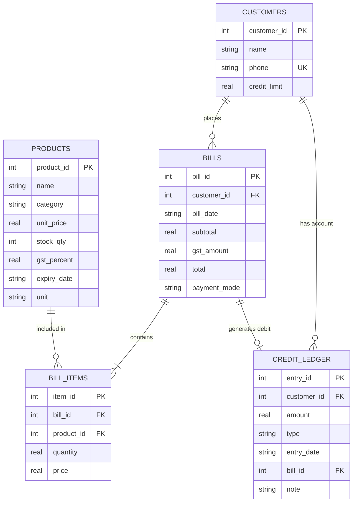

# DukaanDost (दुकानदोस्त) 🏪
### Kirana Store Inventory & Billing AI Agent
**Assessment Submission:** AI Agent Hackathon — **Task T6**  
**Team Name:** `ABHIGYAN`  
**Agent Name:** `DukaanDost`  

---

## 📖 Overview

**DukaanDost** is a purpose-built AI cashier and store manager for Indian kirana (corner grocery) stores. Operating via an interactive CLI and powered by Google Gemini with function calling, it understands natural everyday Hinglish shop phrasing (such as *"udhaar pe daal do"*, *"Sharma ji ka hisab"*, *"do packet Maggi"*), automates billing with GST calculations, enforces safety constraints (preventing sales of expired items or over-limit credit), manages stock, and provides real-time business insights.

All business operations execute against a local **SQLite** database using parameterized queries and atomic transactions via `better-sqlite3`.

---

## 🛠 Tech Stack

- **Runtime:** Node.js 18+ (CommonJS `require`)
- **Database:** SQLite via `better-sqlite3` (synchronous, transaction-safe, PRAGMA foreign keys enabled)
- **AI / LLM:** Google Gemini API with Native Function Calling (`@google/generative-ai` / `@google/genai`)
- **Testing:** Native Node.js test runner (`node:test` and `node:assert`)
- **Configuration:** `dotenv` with strictly isolated credentials

---

## 🗂 Project Structure

```
dukaandost/
├── src/
│   ├── index.js          # CLI entry point: database initialization & interactive chat loop
│   ├── agent.js          # LLM client isolation, session memory, tool calling loop & retry logic
│   ├── db.js             # SQLite connection, schema loader, and financial/customer helpers
│   ├── schema.sql        # Relational schema with CHECK, FOREIGN KEY, and UNIQUE constraints
│   ├── seed.js           # Idempotent database seeder with dynamic relative dates (npm run seed)
│   ├── prompts.js        # System prompt with dynamic date injection & Gemini tool schemas
│   └── tools/
│       ├── products.js   # search_product with fuzzy tokenized matching
│       ├── billing.js    # create_bill with 2-step preview/confirm and atomic transactions
│       ├── inventory.js  # update_stock, low_stock_alert, expiring_soon
│       ├── credit.js     # record_credit_payment, get_customer_balance
│       └── reports.js    # top_selling_products, supplier_order_list, daily_closing_summary
├── tests/
│   ├── billing.test.js   # 11 tests: preview, confirm, stock deduction, GST, limits, rollback
│   ├── inventory.test.js # 12 tests: update stock, low stock thresholds, expiry windows
│   └── credit.test.js    # 7 tests: balance formula, fuzzy matching, overpayments, payments
├── data/
│   └── .gitkeep          # Tracks data directory; dukaandost.db is gitignored
├── .env                  # Environment secrets (placeholder values, gitignored)
├── .env.example          # Template environment file
├── .gitignore            # Ignores .env, node_modules, and SQLite databases
├── package.json          # Scripts: start, seed, test
├── README.md             # Architecture, tools, business rules, setup & ER diagram
└── test_prompts.md       # Real execution transcripts for mandatory prompts and violations
```

---

## 🧰 Tools Reference

DukaanDost provides **8 core tools** plus **2 bonus business reporting tools**. Every tool reads and writes directly to SQLite using parameterized queries (no mock or hard-coded responses):

| # | Tool Name | File | Description |
|---|---|---|---|
| 1 | `search_product` | `src/tools/products.js` | Fuzzy, case-insensitive keyword search by name/category returning prices, stock, and expiry status. |
| 2 | `create_bill` | `src/tools/billing.js` | Enforces 2-step preview/confirm flow; calculates GST, verifies stock & expiry, and executes atomic DB transaction. |
| 3 | `update_stock` | `src/tools/inventory.js` | Adds verified positive quantity to an existing product's inventory. Enforces a 2-step preview/confirm flow: `confirm: false` shows the current stock, quantity to add, and resulting new stock without writing; `confirm: true` applies the update only after user confirmation. |
| 4 | `low_stock_alert` | `src/tools/inventory.js` | Lists products below a threshold (default 10) sorted ascending by stock level. |
| 5 | `expiring_soon` | `src/tools/inventory.js` | Identifies perishable goods expiring within N days (default 7) and items already expired. |
| 6 | `record_credit_payment` | `src/tools/credit.js` | Records customer payment towards udhaar with 2-step preview/confirm and overpayment checks. |
| 7 | `get_customer_balance` | `src/tools/credit.js` | Retrieves outstanding balance, credit limit, available headroom, and recent ledger history. |
| 8 | `top_selling_products` | `src/tools/reports.js` | Aggregates top selling items by volume and revenue for a date range (default: current month). |
| 9 | `supplier_order_list` *(Bonus)* | `src/tools/reports.js` | Recommends restock order quantities for low-stock items to reach target inventory levels. |
| 10 | `daily_closing_summary` *(Bonus)* | `src/tools/reports.js` | Provides store daily closing figures: bill count, total sales split by CASH/UPI/CREDIT, and top item. |

---

## ⚖️ Business Rules & Safety Guards

The following business rules are strictly enforced in **application code** (not solely in prompts):

1. **Two-Step Confirmation for Financial Writes:**
   - `create_bill` and `record_credit_payment` require `confirm: false` to generate an itemized preview.
   - State is held in a module-level session store keyed by a deterministic SHA-256 hash.
   - Calling `confirm: true` without a prior matching preview is rejected.
2. **Expired Product Prohibition:**
   - Products with `expiry_date < today` **cannot be billed** under any circumstance.
   - Items nearing expiry (within 7 days) trigger a visible cashier warning in the preview.
3. **Stock Availability Validation:**
   - Quantities must be positive numbers.
   - Sales exceeding available stock are rejected, specifying the current on-hand quantity.
4. **Credit Headroom Enforcement:**
   - Udhaar (`CREDIT`) requires a registered customer.
   - If `(current_balance + bill_total) > credit_limit`, the sale is refused and available headroom is displayed.
5. **Credit Payment Bounds:**
   - Payments must be positive and cannot exceed the customer's outstanding balance.
6. **Atomic Database Transactions:**
   - Confirming a bill inserts the bill, inserts items, decrements stock, and posts a DEBIT entry in a single SQLite transaction. Any error triggers an immediate full rollback.
7. **No Arbitrary SQL / Parameterized Queries:**
   - All SQL uses prepared statement placeholders (`?`). The LLM is never exposed to raw SQL execution.

---

## 📊 Database Entity-Relationship (ER) Diagram



> *Note:* You can also inspect or attach a hand-drawn schema diagram photo alongside this Mermaid representation.

---

## 🚀 Setup & Execution Guide

### Prerequisites
- Node.js 18.x, 20.x, or 24.x
- npm 9+

### 1. Clone & Install
```bash
git clone <repository_url>
cd dukaandost
npm install
```

### 2. Configure Environment
Copy `.env.example` to `.env`:
```bash
cp .env.example .env
```
Open `.env` and set your Gemini API key:
```env
GEMINI_API_KEY=your_actual_gemini_api_key_here
GEMINI_MODEL=gemini-3.8-flash
DB_PATH=./data/dukaandost.db
```

### 3. Seed Database
Seed 53 products, 10 customers, 16 past bills, and credit transactions relative to today:
```bash
npm run seed
```

### 4. Run Automated Tests
Execute the complete test suite across billing, inventory, and credit modules:
```bash
npm test
```
All 30 tests run against an in-memory SQLite database (`:memory:`) without altering stored production data.

### 5. Launch CLI Chat
Start the interactive DukaanDost assistant:
```bash
npm start
```

---

## 🧪 Mandatory Prompts Verification

See [test_prompts.md](test_prompts.md) for full execution logs, tool call traces, and business rule violation demonstrations.
